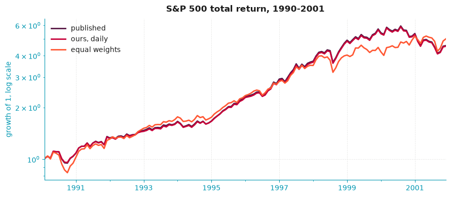
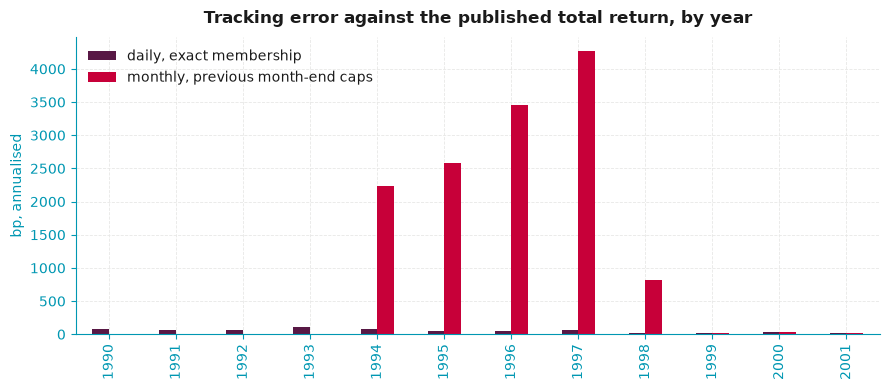
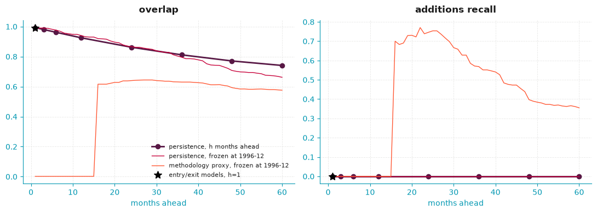
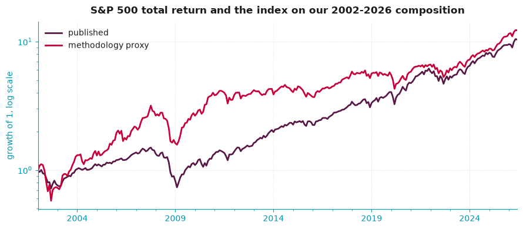

# S&P 500 composition: rules, reproduction, prediction

On 1990-2001 the cap-weighted total-return index built on our month-end composition scores correlation 0.9992, slope 1.0093 and tracking error 57.5 bp against the published S&P 500; equal weights on the same names score slope 0.8622.
Frozen at the 1996-12 cutoff, our rule-based composition scores overlap 0.4619 on 1997-2001 against 0.8293 for persistence, with additions recall 0.4139 at precision 0.1647; past 2002 the index on it scores correlation 0.7676 against the published total return.
One month ahead, our entry and exit classifiers score overlap 0.9926 against 0.9932 for persistence, with additions recall 0.

## The question

Three points on the S&P 500: what decides who enters and who leaves on 1990-2002, where membership is observed; a month-end reconstruction of the composition, checked through the cap-weighted total-return index built on it; and the composition past the vendor's cutoff, at t (2002-2026) and at t+h. The organisers' brief, with the scoring and the baselines.

## Data

The derived panel of the MaQI platform (S&P Global, snapshot 20260711), licensed and not included here; the notebooks read it through the organisers' package on the platform. Point in time: fundamentals enter on `available_from`, the day they became public, and every weight is the cap at the previous month end or trading day. Survivorship: each month's return is earned by the previous month-end membership, names that later leave or stop trading included.

## Approach

Rules. We read them from the membership spells and the panel: how many names change and when, the cap rank of additions, members and deletions, which deletions stop trading, and how many additions pass the methodology's entry screens, rebuilt point in time per company (cap above the level where the largest companies hold 85% of the total, four positive quarters, 12-month dollar volume above 0.30 of cap).

Index. Total returns weighted by the cap at the previous trading day, on the exact daily membership. Next to it: the previous month-end composition held over the month, a monthly build on previous month-end caps, and equal weights. All are scored with `h.score` against `data.index_returns()`, which is only ever the target.

Prediction 1, the composition at t. A recursion from the last observed composition: keep every member that still trades, fill the free slots with names that pass the entry screens, towards each sector's share of large-cap value and then by cap. Tested from the 1996-12 cutoff on 1997-2001, then run from 2001-12 to 2026-06 and checked through the index built on it.

Prediction 2, the composition at t+h. Two classifiers on 1990-2001 security-months, for exits among members and entries among non-members, on size, liquidity, momentum, fundamentals known at t and time in the index, fitted before the cutoff and tested at h = 1. Persistence from 1 to 60 months ahead gives the horizon curve.

## Results

Reproduction, 1990-02 to 2001-12, from `notebooks/01_rules_and_reproduction.ipynb`:

| index on the composition | correlation | slope | tracking error |
|---|---:|---:|---:|
| ours: daily, exact membership | 0.9992 | 1.0093 | 57.5 bp |
| ours: previous month-end composition held over the month | 0.9992 | 1.0099 | 57.6 bp |
| ours: monthly, previous month-end caps (93 months) | 0.5163 | 0.2960 | 2,299 bp |
| equal weights, same pool | 0.9134 | 0.8622 | 623.7 bp |
| brief: the right construction | 0.9995 | 1.0055 | 46 bp |
| brief: equal weights | 0.9135 | 0.8627 | 623 bp |

Predictions scored with `h.composition.score` on 1997-2001, from `notebooks/02_prediction.ipynb`. Additions and deletions are counted against the 1996-12 composition for the frozen rows, and against the composition h months earlier for the others.

| prediction | overlap | additions recall | additions precision | deletions recall | brier |
|---|---:|---:|---:|---:|---:|
| ours, P1: rule-based recursion frozen at 1996-12 | 0.4619 | 0.4139 | 0.1647 | 0.9823 | 0.6661 |
| persistence frozen at 1996-12 | 0.8293 | 0 | 0 | 0.0024 | 0.2781 |
| cap rule with hysteresis, frozen at 1996-12 (brief, not re-run) | 0.78 | | | | |
| ours, P2: entry and exit classifiers, 1 month ahead | 0.9926 | 0 | 0 | 0.0026 | 0.0006 |
| persistence, 1 month ahead | 0.9932 | 0 | 0 | 0 | 0.0127 |
| persistence, 12 months ahead | 0.9251 | 0 | 0 | 0.0011 | 0.1383 |
| cap rule with hysteresis, 12 months ahead (brief, not re-run) | 0.83 | | | | |

The brief measures 0.83 and 0.93 for the two persistence overlaps. The monthly build only has weights from 1998, since monthly market cap is essentially missing before 1998-04; it tracks within 23 to 35 bp a year from 1999. Past the cutoff, the P1 run from 2002-01 to 2026-06 gives an index with correlation 0.7676, slope 0.5655 and tracking error 1,298 bp against the published total return over 294 months: 1,851 bp on 2002-2009, 989 bp on 2010-2019 and 663 bp from 2020 (correlation 0.9225, slope 0.9844).

## Analysis and conclusion

The membership is not a rank cut. On 1998-04 to 2001-12, where monthly caps exist, additions enter at a median cap rank of 575, 60.5% of them outside the top 500, and members are not held to the entry bar: in a given month 54.1% of them rank outside the top 500. Exits come in two kinds: 59% of the 302 deletions of 1990-2001 stop trading within three months of leaving, and 34% still trade a year later. Turnover is uneven, from 9 additions in 1992 to 53 in 2000. The methodology's entry screens, as we rebuilt them, are passed by only 2.7% of additions at entry, and by about one non-member a month for 2.1 additions a month: with caps missing before 1998, the size screen cannot be measured on most of the window, so these screens neither bound nor pick the candidates here.

Persistence sets the bar for how far ahead the composition can be called: overlap 0.9932 at one month, 0.9251 at twelve, 0.7409 at sixty, with no change caught. Frozen at 1996-12, our recursion ends at 0.576 after five years against 0.662 for persistence, and starts near zero because without caps in 1997 it keeps only about ten names a month. At one month the classifiers score 0.9926 against 0.9932: they predict no addition and 0.40 deletions a month, against 3.22 of each in the truth.

The reference build leaves 57.5 bp of tracking error over 1990-2001, from 13 to 103 bp by year, against 46 bp in the brief. Intra-month timing accounts for 7.6 bp; `return_total_daily` and `return_total_daily_raw` give the same 57.5 bp and `return_total_daily_corrected` 36,865 bp, unusable as is; no member-day needed a cap rebuilt from close times shares, and 3.5% carry no weight. Past 2002 the index on our composition leaves 1,298 bp, made of the names the recursion gets wrong (it adds 5 to 27 names a year) and of weighting: the panel has no float, so after the S&P moved to float weights in 2005 our index still weights full caps. The error halves from 2002-2009 to 2010-2019 and falls to 663 bp from 2020.

Limitations. Monthly market cap is essentially missing before 1998-04, which breaks every monthly-cap step before then: the monthly build, the size and liquidity screens, the recursion in 1997 and the index checks of the predictions on 1997-2001 (the observed composition itself scores correlation 0.6231 there). Sector balancing uses today's GICS classification rather than the one in force at t, a look-ahead in the recursion. The daily return field is the one with the lowest tracking error against the target, which is calibration on the target. The recursion hands out probabilities of 0 or 1, so its brier is that of a hard set. The classifiers were built for h = 1 only and need the membership at t, so they cannot run past 2002; the cap rule baseline was not re-implemented; the Nasdaq-100 check past 2002, on a price index, was not done.

Next steps: rebuild the monthly caps from daily close times shares before 1998 and rerun the screens and the recursion on them; turn the entry and exit scores into decisions with the index's real turnover, about 2.1 names a month, instead of a top-N cut; calibrate the probabilities; rank entry candidates rather than classify them; model exits as survival; rebuild sectors point in time; and use the Nasdaq-100 membership as the out-of-sample check past 2002.

## Code organisation

The organisers' package, `src/maqi_hackathon_2`, does the data access and the scoring (`h.score`, `h.composition.score`); we left it untouched, so every number goes through the same scorers. Our code lives in two notebooks, one per half of the brief: `01` measures the rules, builds the company-month eligibility panel and the reproduction, and writes the panel to the data store outside the repository; `02` reads it for the recursion and holds the classifiers. During the hackathon the same code was spread over exploratory notebooks, one per idea (rules and the recursion, the one-month classifiers, the daily index), which these two consolidate. Notebooks kept every number next to the code that produced it; they made reuse hard, since the one-month classifiers existed in two versions with different cutoffs (1995-12 and 1996-12) and the eligibility panel travels between notebooks as a file rather than an import.

The hardest part was turning entry and exit scores into a composition. Entries are rare (0.0212% of non-member months), so classifiers that rank candidates with ROC AUC 0.76 still add no name at one month, and no single score judged a composition fairly: at one month the index on the models and on persistence is the same series, while the change scores give both zero additions recall.

